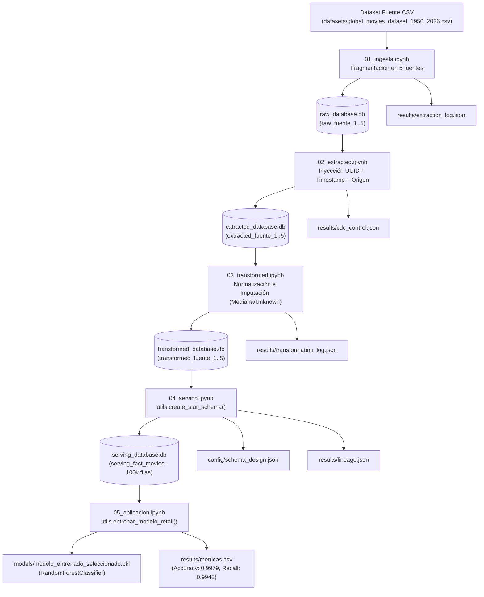

# Documentación Técnica: Movie Data Engineering Medallion (Pipeline de 5 Etapas)

**Autor:** Roberto Alejandro Chagra Martínez  
**Tecnologías:** Python, Jupyter Notebook, Pandas, NumPy, SQLite3, Scikit-Learn, Joblib  
**Tipo:** Pipeline End-to-End de Ingeniería de Datos (Medallion Architecture) y Machine Learning  

---

## 1. Descripción Arquitectónica

Este proyecto implementa un pipeline completo de Ingeniería de Datos sobre el dataset [`datasets/global_movies_dataset_1950_2026.csv`](file:///g:/Mi%20unidad/Drive.alumno.udg.mx/Proyectos/movie-data-engineering-medallion/datasets/global_movies_dataset_1950_2026.csv) ($N = 100,000$ películas). El diseño desacopla el almacenamiento físico en cuatro bases de datos SQLite independientes dentro de [`database/`](file:///g:/Mi%20unidad/Drive.alumno.udg.mx/Proyectos/movie-data-engineering-medallion/database) correspondientes a las capas **Raw**, **Bronze (Extracted)**, **Silver (Transformed)** y **Gold (Serving)**, manteniendo trazabilidad completa mediante bitácoras JSON en [`results/`](file:///g:/Mi%20unidad/Drive.alumno.udg.mx/Proyectos/movie-data-engineering-medallion/logs) y contratos de esquema en [`serving/`](file:///g:/Mi%20unidad/Drive.alumno.udg.mx/Proyectos/movie-data-engineering-medallion/serving).

---

## 2. Diagrama de Flujo del Pipeline

---

## 3. Especificación de Etapas y Módulos

### 3.1. Núcleo Transversal ([`src/utils.py`](file:///g:/Mi%20unidad/Drive.alumno.udg.mx/Proyectos/movie-data-engineering-medallion/utils.py))
- **Gestión Dinámica de Rutas ([`utils.py#L15-L43`](file:///g:/Mi%20unidad/Drive.alumno.udg.mx/Proyectos/movie-data-engineering-medallion/utils.py#L15-L43))**: Calcula `PROYECTO_BASE` dinámicamente y garantiza la existencia de los directorios [`database/`](file:///g:/Mi%20unidad/Drive.alumno.udg.mx/Proyectos/movie-data-engineering-medallion/database), [`results/`](file:///g:/Mi%20unidad/Drive.alumno.udg.mx/Proyectos/movie-data-engineering-medallion/logs), [`models/`](file:///g:/Mi%20unidad/Drive.alumno.udg.mx/Proyectos/movie-data-engineering-medallion/models) y [`serving/`](file:///g:/Mi%20unidad/Drive.alumno.udg.mx/Proyectos/movie-data-engineering-medallion/serving).
- [`get_db_connection(layer)`](file:///g:/Mi%20unidad/Drive.alumno.udg.mx/Proyectos/movie-data-engineering-medallion/utils.py#L49-L57): Enrutador de conexiones SQLite hacia `raw_database.db`, `extracted_database.db`, `transformed_database.db` o `serving_database.db`.
- [`create_star_schema()`](file:///g:/Mi%20unidad/Drive.alumno.udg.mx/Proyectos/movie-data-engineering-medallion/utils.py#L75-L117): Consolida las 5 tablas `transformed_fuente_1..5` de la capa Silver y construye la tabla `serving_fact_movies` en la capa Gold.
- [`entrenar_modelo_retail()`](file:///g:/Mi%20unidad/Drive.alumno.udg.mx/Proyectos/movie-data-engineering-medallion/utils.py#L120-L165): Preprocesa `serving_fact_movies`, elimina atributos textuales/identificadores de alta cardinalidad y entrena un `RandomForestClassifier` sobre la variable objetivo `blockbuster_flag`.

### 3.2. Notebooks del Pipeline
1. **Etapa 1 — Ingesta ([`src/01_ingesta.ipynb`](file:///g:/Mi%20unidad/Drive.alumno.udg.mx/Proyectos/movie-data-engineering-medallion/01_ingesta.ipynb))**: Ordena el dataset por año de lanzamiento (`release_year`), lo divide en 5 particiones de 20,000 registros y genera [`results/extraction_log.json`](file:///g:/Mi%20unidad/Drive.alumno.udg.mx/Proyectos/movie-data-engineering-medallion/results/extraction_log.json).
2. **Etapa 2 — Extracción / Bronze ([`src/02_extracted.ipynb`](file:///g:/Mi%20unidad/Drive.alumno.udg.mx/Proyectos/movie-data-engineering-medallion/02_extracted.ipynb))**: Añade `metadata_uuid`, `metadata_extraction_date` y `metadata_source` a cada lote y actualiza [`results/cdc_control.json`](file:///g:/Mi%20unidad/Drive.alumno.udg.mx/Proyectos/movie-data-engineering-medallion/results/cdc_control.json).
3. **Etapa 3 — Transformación / Silver ([`src/03_transformed.ipynb`](file:///g:/Mi%20unidad/Drive.alumno.udg.mx/Proyectos/movie-data-engineering-medallion/03_transformed.ipynb))**: Estandariza cabeceras e imputa valores nulos, registrando la auditoría en [`results/transformation_log.json`](file:///g:/Mi%20unidad/Drive.alumno.udg.mx/Proyectos/movie-data-engineering-medallion/results/transformation_log.json).
4. **Etapa 4 — Serving / Gold ([`src/04_serving.ipynb`](file:///g:/Mi%20unidad/Drive.alumno.udg.mx/Proyectos/movie-data-engineering-medallion/04_serving.ipynb))**: Materializa `serving_fact_movies`, exporta el diccionario de datos [`config/schema_design.json`](file:///g:/Mi%20unidad/Drive.alumno.udg.mx/Proyectos/movie-data-engineering-medallion/config/schema_design.json) y persiste el linaje en [`results/lineage.json`](file:///g:/Mi%20unidad/Drive.alumno.udg.mx/Proyectos/movie-data-engineering-medallion/results/lineage.json).
5. **Etapa 5 — Aplicación ML ([`src/05_aplicacion.ipynb`](file:///g:/Mi%20unidad/Drive.alumno.udg.mx/Proyectos/movie-data-engineering-medallion/05_aplicacion.ipynb))**: Entrena el clasificador, guarda el artefacto [`models/modelo_entrenado_seleccionado.pkl`](file:///g:/Mi%20unidad/Drive.alumno.udg.mx/Proyectos/movie-data-engineering-medallion/models/modelo_entrenado_seleccionado.pkl) y registra las métricas de validación en [`results/metricas.csv`](file:///g:/Mi%20unidad/Drive.alumno.udg.mx/Proyectos/movie-data-engineering-medallion/results/metricas.csv).
